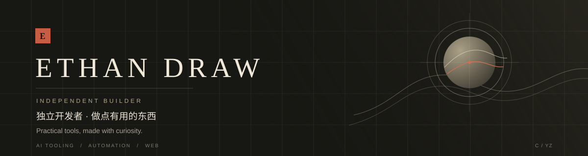

  

  <strong>喜欢动手做实用又有点意思的东西。</strong> 
  Building practical and fun things, big and small.

  AI 工具 · 自动化 · Web 应用　 /　 AI tooling · automation · web applications

---

### Selected work · 精选项目

<table>
  <tr>
    <td width="50%" valign="top">
      01　/　AI TOOLING  
      <a href="https://github.com/cenyangzer/codex-mimo-guide"><strong>Codex × MiMo Setup Guide ↗</strong></a> 
      将小米 MiMo 接入 Codex 桌面端的配置指南。  
      A guide to connecting Xiaomi MiMo with Codex Desktop through a local proxy.  
      <code>AI</code> <code>CODEX</code> <code>LOCAL PROXY</code>
    </td>
    <td width="50%" valign="top">
      02　/　WEB APPLICATION  
      <a href="https://github.com/cenyangzer/tennis-court-booking"><strong>Tennis Court Booking ↗</strong></a> 
      从场地浏览、预约到后台管理的网球馆项目。  
      A court booking system covering browsing, reservations, payments, and administration.  
      <code>FLASK</code> <code>SQLITE</code> <code>WEB</code>
    </td>
  </tr>
</table>

### Current interests · 持续探索

`AI TOOLING`　`AUTOMATION`　`WEB APPLICATIONS`

---

  有想聊的点子或合作，欢迎交流。　/　Open to good ideas and thoughtful collaboration. 
  <a href="https://github.com/cenyangzer">GitHub · cenyangzer ↗</a>

