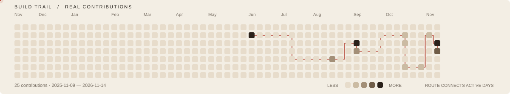

  
  

  <strong>Ethan Draw</strong> · <code>cenyangzer</code> 
  建造、验证，让复杂工具变成可跟着做的步骤。 
  Building, testing, and making complex tools easier to use.

  AI 工具 · 自动化 · Web 应用　/　AI tooling · automation · web applications

---

### Selected projects · 精选项目

| Project | 简介 · About |
| --- | --- |
| [**codex-mimo-guide**](https://github.com/cenyangzer/codex-mimo-guide) | 将小米 MiMo 接入 Codex 桌面端的配置指南。 A setup guide for connecting Xiaomi MiMo to Codex Desktop through a local proxy. |
| [**tennis-court-booking**](https://github.com/cenyangzer/tennis-court-booking) | 基于 Flask + SQLite 的网球馆预约系统，涵盖场地、预约、支付与管理。 A Flask + SQLite booking app for courts, reservations, payments, and administration. |

### Build trail · 循迹

  <picture>
    <source media="(prefers-reduced-motion: reduce) and (prefers-color-scheme: dark)" srcset="./assets/contribution-trail-static-dark.svg">
    <source media="(prefers-reduced-motion: reduce)" srcset="./assets/contribution-trail-static-light.svg">
    <source media="(prefers-color-scheme: dark)" srcset="./assets/contribution-trail-dark.svg">
    
  </picture>

方格与计数来自 GitHub 真实记录；微光、余辉和呼吸格只沿实际贡献日期运行。 Cells and counts reflect real GitHub activity. Motion follows active dates; a static image is used when reduced motion is preferred.

### Current interests · 持续探索

`AI TOOLING`　`AUTOMATION`　`WEB APPLICATIONS`

---

  有想聊的点子或合作，欢迎交流。 
  Open to good ideas and thoughtful collaboration. 
  <a href="https://github.com/cenyangzer">GitHub · cenyangzer ↗</a>

